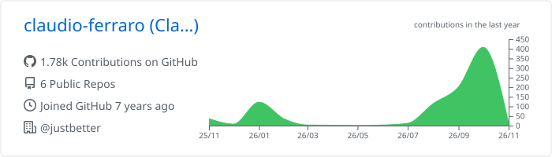
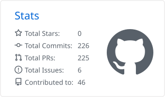
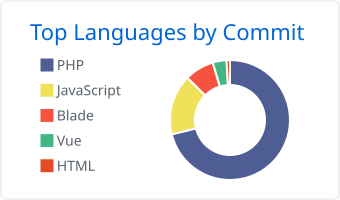
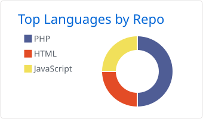
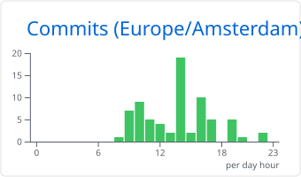

  

# Claudio Ferraro
Full‑stack developer at JustBetter - PHP | Laravel | Magento 2 | AI - building large B2C and B2B e‑commerce, headless storefronts and AI‑driven applications.

---

## 🔭 About me
I'm Claudio, a full‑stack developer at [JustBetter](https://justbetter.nl). My focus is e‑commerce: large, complex B2C and B2B webshops on Magento 2 and [Rapidez](https://rapidez.io) (the headless Magento frontend built with Laravel and Vue), integrated with ERP, CRM and Akeneo PIM. Alongside that I build Laravel applications and Statamic websites. JustBetter also maintains open‑source packages like [magento2-sentry](https://github.com/justbetter/magento2-sentry) (1.7M+ installs) and [laravel-magento-client](https://github.com/justbetter/laravel-magento-client).

AI is a big part of how I work. I develop with Claude and build AI into applications, from new AI‑driven products to smart features in existing systems. I also use AI to improve the way we work, from workflows to code reviews.

## ⚡ Currently
- Developing with Claude, both hands‑on and autonomously
- Building AI features with the [Laravel AI SDK](https://github.com/laravel/ai)
- Working on my own SaaS products with Laravel and Filament

---

## 🛠️ Tech Stack

---

## 📊 GitHub stats

  <picture>
    <source media="(prefers-color-scheme: dark)" srcset="./profile-summary-card-output/github_dark/0-profile-details.svg">
    
  </picture>

  <picture>
    <source media="(prefers-color-scheme: dark)" srcset="./profile-summary-card-output/github_dark/3-stats.svg">
    
  </picture>
  <picture>
    <source media="(prefers-color-scheme: dark)" srcset="./profile-summary-card-output/github_dark/2-most-commit-language.svg">
    
  </picture>

  <picture>
    <source media="(prefers-color-scheme: dark)" srcset="./profile-summary-card-output/github_dark/1-repos-per-language.svg">
    
  </picture>
  <picture>
    <source media="(prefers-color-scheme: dark)" srcset="./profile-summary-card-output/github_dark/4-productive-time.svg">
    
  </picture>

## 🚀 Latest merged contributions
<!-- ACTIVITY:START -->
- [Added magento2-sentry V5 to requirements](https://github.com/justbetter/magento2-sentry-filter-events/pull/10) in `justbetter/magento2-sentry-filter-events`
- [Respect stock configuration and backorders when uncancelling an order](https://github.com/paynl/magento2-plugin/pull/250) in `paynl/magento2-plugin`
- [[5.x] Added Mage-OS to the Playwright tests](https://github.com/rapidez/core/pull/1434) in `rapidez/core`
- [Implement JustBetter_SentryLogrocket module](https://github.com/justbetter/magento2-sentry-logrocket/pull/1) in `justbetter/magento2-sentry-logrocket`
- [Added Javascript issue grouping by controller action](https://github.com/justbetter/magento2-sentry/pull/251) in `justbetter/magento2-sentry`
<!-- ACTIVITY:END -->

---

## 🤝 Get in touch

Interested in collaborating on e‑commerce, Laravel or AI projects? Send a message - I'll get back to you.
